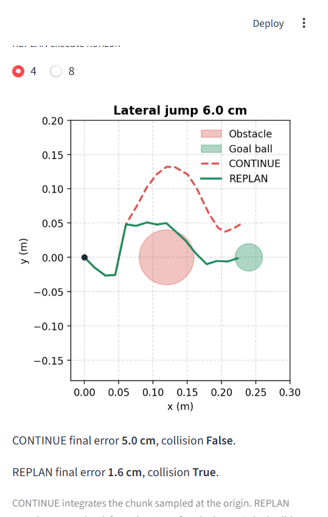

# diffusion-recovery-bench

Synthetic benchmark for three questions about an action-chunk diffusion policy: how long DDIM sampling takes, whether it picks one corridor when MSE regression averages them, and whether receding-horizon replanning recovers from a 6 cm lateral jump.

The suite does not start Isaac Sim, ORBIT, or a robot. Numbers in [BENCHMARK_RESULTS.md](BENCHMARK_RESULTS.md) are one run of this planar check.

## Demo

`streamlit run app.py` opens a local board. The latency bars and the success table come from the last benchmark file. The perturbation slider replays CONTINUE and REPLAN on the saved planar policy.



This frame is one seed at a 6 cm jump. CONTINUE finishes 5.0 cm off the goal. REPLAN comes back toward the goal ball and, on this seed, still clips the disk. The table on that page is the 32-trial measurement, not this single draw.

## Benchmark Visualizations

| DDIM latency | Mode separation | 6 cm recovery |
| :---: | :---: | :---: |
|  |  |  |

## Tracks

| Track | Question | Primary metrics |
| --- | --- | --- |
| Latency | Does action-head P99 fit in a 20 ms (50 Hz) or 50 ms (20 Hz) period? | P50, P95, P99, `meets_50hz_20ms` |
| Multimodal | Does MSE cloning drive through the disk while diffusion picks a side? | collision rate, side fraction |
| Recovery | After a +6 cm jump, does REPLAN reach the goal ball while CONTINUE stays offset? | success rate, median final error |

Latency uses a randomly initialized denoiser with action dim 7, observation dim 128, and a 16-step chunk. One row times that head alone. The other row also runs a small random conv net on a 128×128 image. The behavior tracks train a 2D copy of the same denoiser on analytic left/right corridors around a disk.

## Setup

Python 3.10+ and `requirements.txt`. A CPU wheel is enough.

```bash
python -m pip install -r requirements.txt
python -m diffusion_bench.runner --synthetic --output results/benchmark_report.json
```

`--synthetic` is required. The run writes `results/benchmark_report.json`, `results/*.csv`, `BENCHMARK_RESULTS.md`, `results/planar_policy.pt`, and the figures under `docs/figures/`.

Useful knobs: `--epochs` (50), `--trials` (32), `--latency-runs` (80), `--sample-steps` (10), `--diffusion-steps` (50), `--seed` (0).

The flow-matching comparison is a second run. It keeps the saved DDIM checkpoint and trains a velocity field on the same corridors:

```bash
python -m diffusion_bench.flow_compare --synthetic
```

Numbers are in [FLOW_MATCHING_RESULTS.md](FLOW_MATCHING_RESULTS.md).

## Layout

```
diffusion_bench/
  task.py         corridors, obstacle tests, dataset windows
  models.py       temporal-conv denoiser, vision stub, MLP baseline
  diffusion.py    cosine schedule and DDIM
  policies.py     CONTINUE and REPLAN rollouts
  experiments.py  the three tracks
  runner.py       CLI
```
