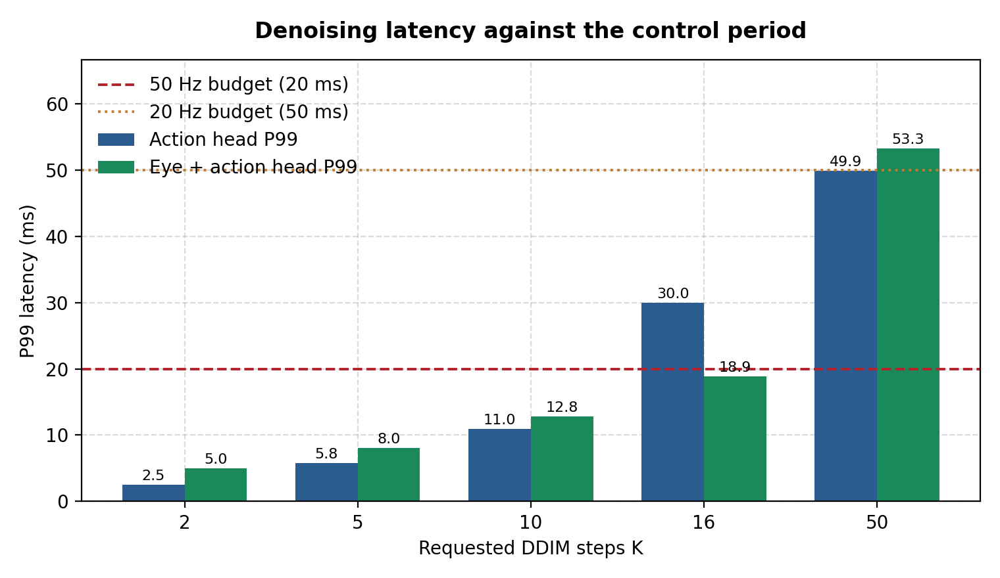
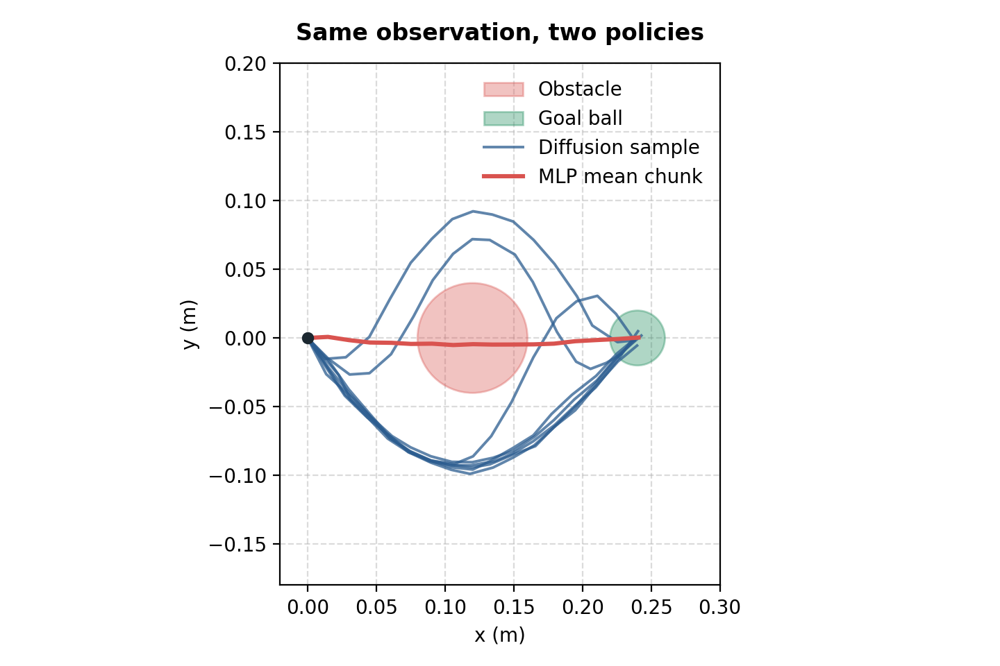
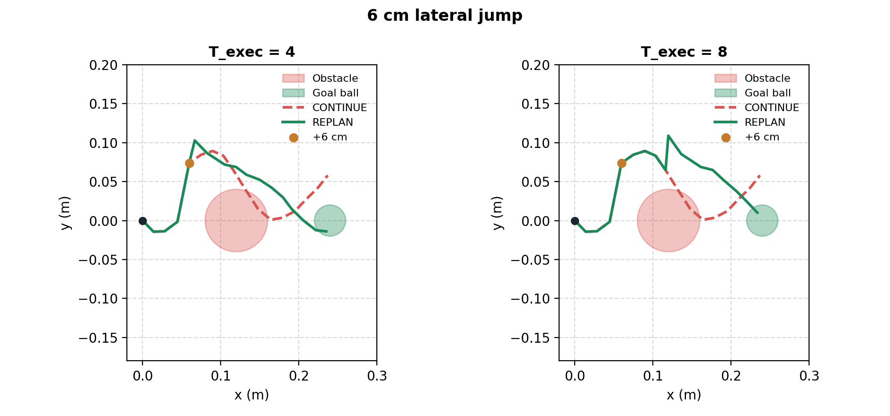
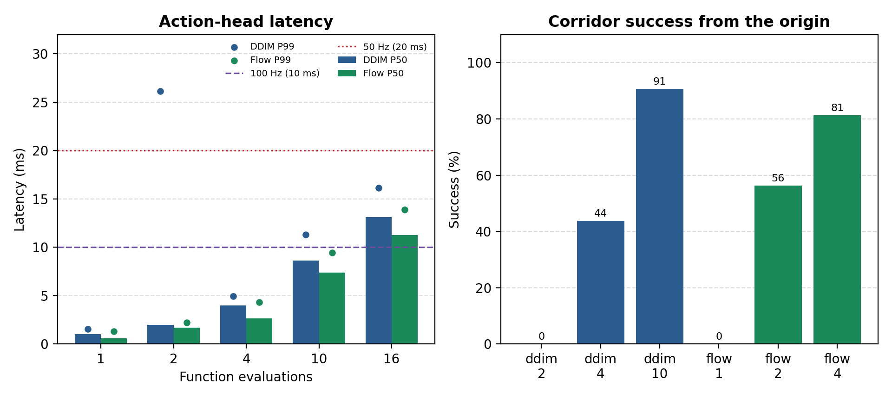

# diffusion-recovery-bench

Synthetic benchmark for an action-chunk policy on a planar point mass. It times denoising, checks whether the policy picks one corridor when MSE regression averages two, and checks whether receding-horizon replanning recovers from a 6 cm lateral jump.

The suite does not start Isaac Sim, ORBIT, or a robot. [BENCHMARK_RESULTS.md](BENCHMARK_RESULTS.md) is the DDIM run. [FLOW_MATCHING_RESULTS.md](FLOW_MATCHING_RESULTS.md) is the Euler flow-matching comparison on the same corridors and the same epoch budget.

## Results

| DDIM latency | Mode separation | 6 cm recovery |
| :---: | :---: | :---: |
|  |  |  |



On this CPU the action head at DDIM K=10 has P99 11.3 ms and 91% origin success. Flow matching at 4 Euler steps has P99 4.3 ms and 81% origin success. Flow matching at 1 step recovers after the 6 cm jump (97%) and misses the disk from the symmetric origin (0%).

## Tracks

| Track | Question | Primary metrics |
| --- | --- | --- |
| Latency | Does action-head P99 fit in 20 ms (50 Hz) or 10 ms (100 Hz)? | P50, P99 |
| Multimodal | Does MSE cloning drive through the disk while a sampler picks a side? | collision rate, side fraction |
| Recovery | After a +6 cm jump, does REPLAN reach the goal ball while CONTINUE stays offset? | success rate, median final error |

Latency uses a randomly initialized denoiser with action dim 7, observation dim 128, and a 16-step chunk. One condition times that head alone. The other also runs a small random conv net on a 128×128 image. The behavior tracks train a 2D copy of the same denoiser on analytic left/right corridors around a disk.

## Setup

Python 3.10+ and `requirements.txt`. A CPU wheel is enough.

```bash
python -m pip install -r requirements.txt
python -m diffusion_bench.runner --synthetic --output results/benchmark_report.json
python -m diffusion_bench.flow_compare --synthetic
```

`--synthetic` is required. The first command writes `results/benchmark_report.json`, `results/*.csv`, `BENCHMARK_RESULTS.md`, `results/planar_policy.pt`, and the DDIM figures. The second command reads that checkpoint, trains the velocity field, and writes `FLOW_MATCHING_RESULTS.md`.

Useful knobs: `--epochs` (50), `--trials` (32), `--latency-runs` (80), `--sample-steps` (10), `--diffusion-steps` (50), `--seed` (0).

## Layout

```
diffusion_bench/
  task.py           corridors, obstacle tests, dataset windows
  models.py         temporal-conv denoiser, vision stub, MLP baseline
  diffusion.py      cosine schedule and DDIM
  flow.py           straight-line velocity loss and Euler sampling
  policies.py       CONTINUE and REPLAN rollouts
  experiments.py    the three DDIM tracks
  flow_compare.py   DDIM versus flow matching
  runner.py         CLI
```
